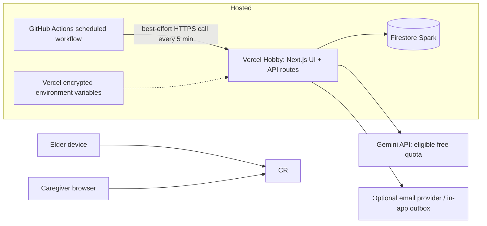
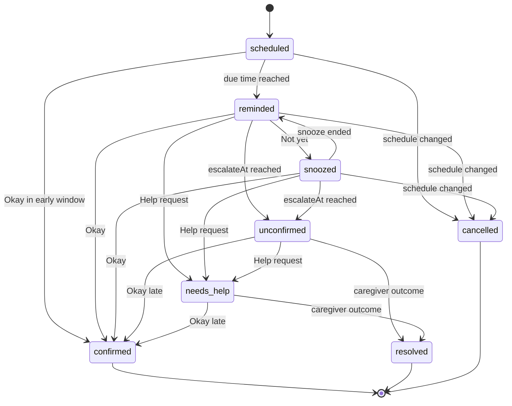
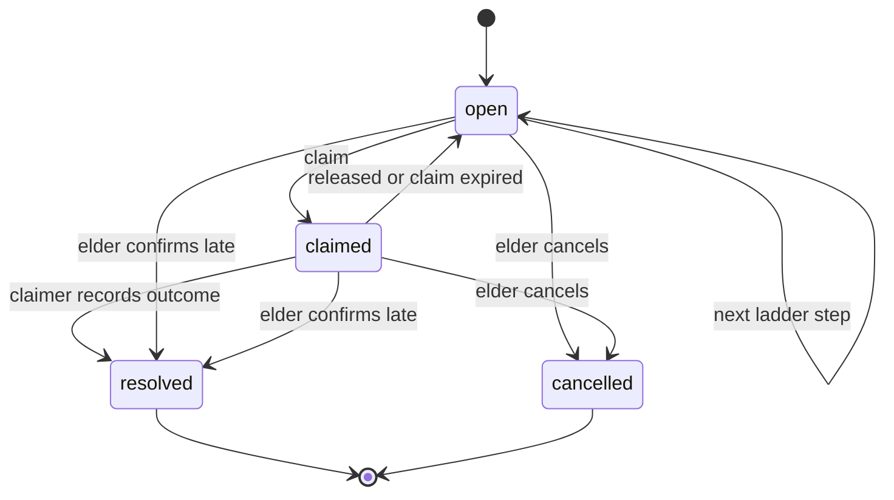

# SAATHI_REFERENCE.md

**Product:** SAATHI, a consent-first elderly care coordination platform
**Fixed stack (zero-payment target):** Next.js (App Router) + TypeScript + Tailwind · Firestore Spark (Admin SDK only) · Gemini API only within eligible free quota · Vercel Hobby · GitHub Actions scheduled workflow (best effort)
**Status:** implementation-ready reference for a 7-hour build · **Deployment:** Vercel + Firebase Spark, no Google Cloud billing account · **Updated:** 2026-11-15

> **ZERO-COST DEPLOYMENT OVERRIDE (authoritative for this project):** This version is adapted for Vercel Hobby + Firebase Spark + GitHub Actions, with no Google Cloud billing account. Do not implement Cloud Run, Cloud Scheduler, Google Secret Manager, Docker deployment, service-account IAM roles, Scheduler OIDC, `output: standalone`, or `min-instances`. Use Vercel encrypted environment variables for server secrets. Use GitHub Actions scheduled/manual workflows as a best-effort trigger for the protected, idempotent `process-due` endpoint. GitHub scheduled jobs can be delayed or skipped; keep a manual demo trigger and request-time catch-up. Never promise exact-time medical alerts. Confirm current free-plan limits at setup; do not enable billing or paid services.
> **AUTHENTICATION OVERRIDE:** Adult caregiver, family, and emergency-contact identity uses Firebase Authentication. Store the verified Firebase UID on the member and never store a SAATHI adult passcode. Elders use a distinct PIN for step-up and a one-time device pairing code. This override replaces conflicting passcode-login wording below.
**Document rule:** schemas, contracts and behaviour only. No application code.

---

## 0. Scope, priorities and time budget

**One-line promise:** other apps ask "did you take it?"; SAATHI asks "are you okay, and who should help?"

**Assumptions (state them in the README):**
- One elder per circle. One circle per adult Firebase UID (MVP limit).
- Email is the only intended outbound channel; no push or SMS. In-app notifications are mandatory. Real email delivery is optional until a no-cost provider is configured and tested; never claim log-mode messages were emailed.
- Elder reminders appear in the app on a paired device left open (tablet or phone). Email is the optional fallback when a no-cost provider is configured and verified; never represent log-mode or in-app alerts as delivered email.
- Medication schedules are fixed clock times. No dosing logic, no interaction checks, no medical advice anywhere.
- "Confirmed" always means **reported by the elder**. It is not proof that a medicine was taken.

### Priorities

| Pri | Feature | Why |
|---|---|---|
| **P0** | Vercel deploy with `/api/health` (first 30 min) | A broken live URL undermines deployment/completeness scoring |
| **P0** | Circle, consent, Firebase Auth roles, elder PIN and pairing, permissions | Core brief and security score |
| **P0** | Medications, dose materialization, Care Signals | Core feature 1 |
| **P0** | Escalation ladder, alerts, atomic "I've got it", email outbox | Core feature 2 (the differentiator) |
| **P0** | Care Memory timeline | Core feature 3 |
| **P0** | Elder screen accessibility, English and Hindi | Accessibility score and the "elder at centre" brief |
| **P1** | Scan the Prescription (Gemini, human approval) | Core feature 4, strong demo |
| **P1** | Appointments CRUD and 24h/2h reminders | Brief requirement |
| **P1** | Handoff summary (deterministic, no AI) | Care Memory polish |
| **P2** | Judge demo sandbox, `.ics` export, invite emails | Only if ahead of schedule |

### Build order (about 6h40m of work, 20 min buffer)

| Min | Block |
|---|---|
| 30 | Scaffold, standard Next.js/Vercel build, deploy `/api/health`, create Firestore Spark database (choose location once), indexes file |
| 60 | Domain types, Firebase Auth session exchange, pairing, elder PIN step-up, circle creation, consent, members, permissions |
| 40 | Medications CRUD, dose materialization, elder `GET /api/doses` |
| 40 | Elder screen and Care Signals (large UI, EN/HI, text size) |
| 90 | Process-due job, ladder, alerts, claim/release/resolve, outbox and email |
| 40 | Care Memory, caregiver dashboard, handoff |
| 20 | Appointments |
| 40 | Gemini scan with review/approve screen |
| 40 | Accessibility pass, remaining tests, README table, final deploy and submission checks |

**Cut order if behind:** demo sandbox → `.ics` → handoff summary → scan → appointment emails → Hindi on caregiver screens (never on elder screens).
**Never cut:** Care Signals, escalation ladder, atomic claim, working deployment.

---

## 1. Architecture



### Key decisions
1. **Server-only data access.** The browser never talks to Firestore. All reads and writes go through route handlers using the Admin SDK. Firestore security rules deny everything.
2. **Database-driven timers.** There are no `setTimeout` or `node-cron` timers. Every pending action is a `nextActionAt` timestamp. A GitHub Actions scheduled workflow calls `process-due` approximately every 5 minutes (best effort; schedules can be delayed or skipped). The endpoint is also manually triggerable for the demo, and the job is idempotent. Process overdue actions when an authorized dashboard is opened as an additional catch-up path.
3. **Everything important is an event.** Care Memory is the `events` collection, which makes it nearly free.
4. **Outbox for email.** Transactions write notification documents. A separate bounded worker step sends them. On a strict zero-cost setup, in-app notifications remain mandatory; real email is enabled only after a no-payment provider path is configured and tested.
5. **Session decides the circle.** The client never supplies `circleId` for authorization. Routes are `/api/medications`, not `/api/circles/:id/medications`.
6. **Gemini does one job:** transcribe a prescription photo into candidates. It never schedules, advises or summarizes.

### Module boundaries (for the code-quality score)
`lib/domain` (pure state transitions, no I/O) · `lib/repo` (Firestore access) · `lib/auth` (sessions, hashing, authorize) · `lib/notify` (templates, outbox, sender interface) · `lib/gemini` (prompt, schema, validation) · `lib/i18n` (en/hi dictionaries) · `app/api/**/route.ts` (thin: parse, authorize, call domain/repo).
Route handlers declare `runtime = nodejs` and `dynamic = force-dynamic`.

### Platform configuration

| Item | Value |
|---|---|
| Firestore location | Choose one Firebase/Firestore location once; it cannot be changed later. Do not create Google Cloud hosting or scheduling resources. |
| Vercel | Connect the public GitHub repository; use the standard Next.js build and Vercel Hobby deployment. No Docker or standalone output is required. Public app access is allowed, but every private API must enforce application authentication and authorization. |
| Scheduled workflow | GitHub Actions `schedule` workflow on the default branch, approximately every 5 minutes (best effort), plus `workflow_dispatch` for manual demo runs. It calls POST `/api/tasks/process-due` using a high-entropy `JOB_TRIGGER_SECRET`. Never expose the endpoint without authentication. |
| Secrets (Vercel encrypted environment variables) | `FIREBASE_PROJECT_ID`, `FIREBASE_CLIENT_EMAIL`, `FIREBASE_PRIVATE_KEY`, `GEMINI_API_KEY` (optional), `ELDER_PIN_PEPPER`, `PAIRING_CODE_PEPPER`, `JOB_TRIGGER_SECRET`, optional email-provider credentials |
| GitHub Actions secrets | `SAATHI_BASE_URL`, `JOB_TRIGGER_SECRET`; add email credentials only if a GitHub Actions worker sends email. Never put secrets in workflow YAML. |
| Plain env | `GEMINI_MODEL` (use a currently available model and eligible free quota only), `EMAIL_MODE` (`log` by default; enable a real provider only after testing), `EMAIL_FROM`, `APP_BASE_URL`, `DEMO_MODE`, `JOB_BATCH_LIMIT` |
| Repo hygiene | `.env.example` with names only, no values; lockfile committed; secrets never in `NEXT_PUBLIC_*` |

---

## 2. Firestore schema

### Conventions
- All timestamps are Firestore `Timestamp` (UTC). Samples show ISO strings.
- Top-level collections with `circleId` on every document (simple queries, no collection-group indexes).
- Deterministic document IDs wherever idempotency matters (marked ⚑).
- `version` increments on every write to mutable documents.
- Circle timezone is an IANA name (`Asia/Kolkata`). Schedule times are stored as local `HH:mm` strings.
- API responses use explicit DTOs. Never return a raw Firestore document (hashes, internal flags).

### Collections

| Collection | Purpose | Doc ID | TTL field |
|---|---|---|---|
| `circles` | Elder profile, policy, privacy, consent | auto | none |
| `members` | Elder and circle members, permissions, credentials | adult: SHA-256 of Firebase UID; elder: auto | none |
| `sessions` | Server-side sessions | ⚑ SHA-256 of cookie token | `expiresAt` |
| `invites` | One-time member invites and elder-device pairing codes | ⚑ HMAC of code | `expiresAt` |
| `medications` | Schedule definitions | auto, or ⚑ `{scanId}_{candidateId}` | none |
| `doses` | One document per scheduled occurrence | ⚑ `{medId}_{yyyyMMddTHHmm local}` | none |
| `alerts` | Escalation and help items | ⚑ `dose_{doseId}` or `help_{requestId}` | none |
| `events` | Append-only Care Memory | auto, or ⚑ `evt_{doseId}_{requestId}` | none |
| `notifications` | Email outbox | ⚑ `{alertId}__s{step}__{memberId}` | `expireAt` (30d) |
| `appointments` | Doctor visits | auto | none |
| `scans` | Pending prescription extractions | auto | `expireAt` (24h) |
| `rateLimits` | Attempt counters and lockouts | ⚑ key hash | `expireAt` |

**TTL deletion is not immediate** (it can lag by up to a day). Code must always check `expiresAt` itself.

### Sample documents

**`circles/cir_8f3k`**
```json
{
  "elderName": "Kamla Devi",
  "preferredName": "Dadi",
  "language": "hi",
  "timezone": "Asia/Kolkata",
  "status": "active",
  "demo": false,
  "emergencyNumber": "112",
  "consent": { "acceptedAt": "2026-11-15T04:10:00Z", "acceptedByMemberId": "mem_elder1", "version": 1 },
  "policy": {
    "followUpAfterMinutes": 10,
    "graceMinutes": 30,
    "snoozeMinutes": 15,
    "maxSnoozes": 3,
    "maxDelayMinutes": 90,
    "stepGapMinutes": 20,
    "helpStepGapMinutes": 5,
    "claimWindowMinutes": 30,
    "finalRepeats": 2
  },
  "ladder": [
    { "step": 1, "audience": "primary" },
    { "step": 2, "audience": "backup" },
    { "step": 3, "audience": "all_alert_recipients" }
  ],
  "privacy": { "defaultAppointmentVisibility": "caregivers" },
  "activeHelpAlertId": null,
  "createdBy": "mem_cg1",
  "createdAt": "2026-11-15T03:50:00Z",
  "updatedAt": "2026-11-15T04:10:00Z",
  "version": 3
}
```
`status`: `pending_consent`, `active`. Policy bounds (validated on write; the demo circle may go down to 1 minute):

| Field | Allowed range |
|---|---|
| followUpAfterMinutes | 5–30 |
| graceMinutes | 10–120 |
| snoozeMinutes | 5–30 |
| maxSnoozes | 0–5 |
| maxDelayMinutes | ≥ graceMinutes, ≤ 180 |
| stepGapMinutes | 5–60 |
| helpStepGapMinutes | 1–30 |
| claimWindowMinutes | 10–120 |
| finalRepeats | 0–3 |

**`members/mem_cg1`** (caregiver)
```json
{
  "circleId": "cir_8f3k",
  "role": "caregiver",
  "tier": "primary",
  "displayName": "Riya",
  "relation": "daughter",
  "email": "riya@example.com",
  "emailNormalized": "riya@example.com",
  "firebaseUid": "firebase-auth-uid",
  "language": "en",
  "permissions": {
    "viewSchedule": true, "viewHistory": true, "editMedications": true,
    "editAppointments": true, "viewPrivateAppointments": false,
    "receiveAlerts": true, "manageCircle": false
  },
  "notify": { "appointments": true, "updates": true },
  "status": "active",
  "createdAt": "2026-11-15T03:50:00Z",
  "version": 1
}
```
Roles: `elder`, `caregiver`, `family`, `emergency_contact`. Adult members have a `firebaseUid` linked to Firebase Authentication; SAATHI does not store or verify their passwords. The elder device member has `pinHash` (scrypt plus `ELDER_PIN_PEPPER`) and no Firebase Auth credential. Tiers: `primary`, `backup`, `circle`. The elder has all permissions implicitly. Status: `active` or `removed`. Grantable flags by role are in §5.

**`medications/med_201`**
```json
{
  "circleId": "cir_8f3k",
  "name": "Metformin",
  "strength": "500 mg",
  "form": "tablet",
  "instructionText": "after food",
  "label": "White tablet, after breakfast",
  "times": ["09:00", "21:00"],
  "daysOfWeek": [0, 1, 2, 3, 4, 5, 6],
  "startDate": "2026-11-15",
  "endDate": null,
  "status": "active",
  "source": "scan",
  "scanId": "scn_91",
  "createdBy": "mem_cg1",
  "materializedThrough": "2026-11-17T18:29:00Z",
  "version": 2
}
```
`instructionText` is text copied from the prescription or typed by a person. SAATHI never generates it. `label` is the elder-friendly wording. Paused or archived medications have `materializedThrough` **deleted** so they leave the materialization query.

**`doses/med_201_20261115T0900`** ⚑
```json
{
  "circleId": "cir_8f3k",
  "medicationId": "med_201",
  "snapshot": { "name": "Metformin", "strength": "500 mg", "label": "White tablet, after breakfast" },
  "scheduledAt": "2026-11-15T03:30:00Z",
  "state": "snoozed",
  "snoozeCount": 1,
  "snoozedUntil": "2026-11-15T03:45:00Z",
  "followUpSentAt": null,
  "escalateAt": "2026-11-15T04:00:00Z",
  "nextAction": "remind",
  "nextActionAt": "2026-11-15T03:45:00Z",
  "alertId": null,
  "confirmedAt": null,
  "version": 4
}
```
States: `scheduled`, `reminded`, `snoozed`, `unconfirmed`, `needs_help`, `confirmed`, `resolved`, `cancelled`. In terminal states, `nextAction` and `nextActionAt` are **deleted**. The `snapshot` keeps history correct after medication edits.

**`alerts/dose_med_201_20261115T0900`** ⚑
```json
{
  "circleId": "cir_8f3k",
  "type": "unconfirmed_dose",
  "doseId": "med_201_20261115T0900",
  "reason": null,
  "status": "claimed",
  "step": 1,
  "exhausted": false,
  "finalRepeatsDone": 0,
  "notifiedMemberIds": ["mem_cg1"],
  "claimedBy": "mem_cg1",
  "claimedAt": "2026-11-15T04:06:10Z",
  "claimExpiresAt": "2026-11-15T04:36:10Z",
  "nextAction": "claim_expiry",
  "nextActionAt": "2026-11-15T04:36:10Z",
  "resolvedBy": null,
  "outcome": null,
  "createdAt": "2026-11-15T04:00:05Z",
  "version": 3
}
```
Types: `unconfirmed_dose`, `help_request` (with `reason`: `medicine_finished`, `feel_unwell`, `call_me`, `other`). Status: `open`, `claimed`, `resolved`, `cancelled`. Outcomes: `spoke_with_elder`, `visited_in_person`, `medicine_arranged`, `other`, `elder_confirmed_late`, `cancelled_by_elder`.

**`events/evt_x91`**
```json
{
  "circleId": "cir_8f3k",
  "type": "alert.claimed",
  "actor": { "memberId": "mem_cg1", "displayName": "Riya", "role": "caregiver" },
  "subject": { "kind": "alert", "id": "dose_med_201_20261115T0900" },
  "data": { "label": "White tablet, after breakfast" },
  "visibleToRoles": ["elder", "caregiver", "family", "emergency_contact"],
  "createdAt": "2026-11-15T04:06:10Z"
}
```
Event types: `circle.created`, `elder.profile_created`, `session.revoked`, `device.pairing_code_created`, `device.paired`, `device.revoked`, `pin.changed`, `member.invited/joined/removed`, `invite.accepted`, `permissions.changed`, `policy.changed`, `consent.accepted`, `dose.confirmed`, `dose.snoozed`, `dose.unconfirmed`, `help.requested`, `alert.created`, `alert.notified`, `alert.claimed`, `alert.released`, `alert.claim_expired`, `alert.exhausted`, `alert.resolved`, `alert.cancelled`, `medication.created/updated/paused`, `scan.approved`, `appointment.created/updated/deleted`.
Events store **keys and data, not sentences**. The client renders text from i18n keys, so Hindi works. Events about private appointments set `visibleToRoles: ["elder"]`. Everything that others change about the elder's circle is visible to the elder (transparency).

**`notifications/dose_med_201_20261115T0900__s1__mem_cg1`** ⚑
```json
{
  "circleId": "cir_8f3k",
  "memberId": "mem_cg1",
  "category": "unconfirmed_dose",
  "template": "alert_step",
  "params": { "alertId": "dose_med_201_20261115T0900", "step": 1, "elderName": "Dadi", "timeLocal": "9:00 AM" },
  "language": "en",
  "status": "pending",
  "pendingSendAt": "2026-11-15T04:00:05Z",
  "leaseUntil": null,
  "attempts": 0,
  "providerMessageId": null,
  "expireAt": "2026-12-15T04:00:05Z",
  "createdAt": "2026-11-15T04:00:05Z"
}
```
Status: `pending`, `sent`, `failed`, `suppressed` (with `suppressedReason`). `pendingSendAt` exists **only while pending** (sparse-field pattern, §9). Params never contain medicine names or help reasons.

**`appointments/apt_55`**
```json
{
  "circleId": "cir_8f3k",
  "title": "Doctor visit",
  "doctorName": "Dr. Mehta",
  "location": "City Clinic",
  "startsAt": "2026-11-18T05:00:00Z",
  "visibility": "caregivers",
  "status": "scheduled",
  "reminders": { "24h": null, "2h": null },
  "nextReminderAt": "2026-11-17T05:00:00Z",
  "createdBy": "mem_cg1",
  "version": 1
}
```
Visibility: `elder_only`, `caregivers`, `circle`. `nextReminderAt` is deleted once both reminders are sent or the appointment passes.

**`scans/scn_91`**
```json
{
  "circleId": "cir_8f3k",
  "createdBy": "mem_cg1",
  "status": "pending_review",
  "schemaVersion": 1,
  "model": "<value of GEMINI_MODEL>",
  "candidates": [
    {
      "candidateId": "c1",
      "name":            { "value": "Metformin", "flag": "ok" },
      "strength":        { "value": "500 mg",    "flag": "ok" },
      "form":            { "value": null,        "flag": "missing" },
      "frequencyText":   { "value": "BD",        "flag": "check" },
      "instructionText": { "value": "after food","flag": "ok" },
      "durationText":    { "value": null,        "flag": "missing" }
    }
  ],
  "documentWarnings": ["Photo is slightly blurred"],
  "expireAt": "2026-11-16T04:00:00Z",
  "createdAt": "2026-11-15T04:00:00Z"
}
```
`flag` is derived server-side: `missing` (null), `check` (model marked illegible or value fails a format check), otherwise `ok`. The image is **never stored**; the browser keeps it locally for side-by-side review. Status: `pending_review`, `approved`, `rejected`.

**Field lists for the remaining collections**
- `sessions`: `memberId`, `circleId`, `role`, `kind` (`member` or `elder_device`), `elevatedUntil`, `createdAt`, `lastSeenAt`, `expiresAt`.
- `invites`: `circleId`, `kind` (`member` or `elder_device`), `role`, `tier`, `name`, `email?`, `permissions`, `createdBy`, `usedAt`, `expiresAt`. The code itself is never stored, only its HMAC.
- `rateLimits`: `count`, `windowStart`, `lockedUntil`, `expireAt`.

### Required indexes (`firestore.indexes.json`, deployed in hour 1)

| Collection | Fields | Used by |
|---|---|---|
| `doses` | `circleId` ASC, `scheduledAt` ASC | Today's schedule |
| `events` | `circleId` ASC, `visibleToRoles` CONTAINS, `createdAt` DESC | Care Memory |
| `alerts` | `circleId` ASC, `status` ASC, `createdAt` DESC | Open items |
| `appointments` | `circleId` ASC, `startsAt` ASC | Upcoming list |
| `members` | `circleId` ASC, `status` ASC | Circle membership list |
| `members` | `circleId` ASC, `role` ASC, `status` ASC | Elder profile lookup |
| `sessions` | `circleId` ASC, `kind` ASC | Paired device list |

Single-field range queries need no composite index: `doses.nextActionAt`, `alerts.nextActionAt`, `appointments.nextReminderAt`, `notifications.pendingSendAt`, `medications.materializedThrough`.
TTL policies: `sessions.expiresAt`, `invites.expiresAt`, `scans.expireAt`, `rateLimits.expireAt`, `notifications.expireAt`.
Firestore rules: deny all reads and writes. The Admin SDK bypasses them.

---

## 3. API contracts

### Conventions
- JSON over HTTPS. Auth by an HttpOnly cookie (`__Host-saathi_session` in production). Times are ISO-8601 UTC.
- Mutating requests need `Content-Type: application/json` (scan upload is multipart) and a matching `Origin`.
- `requestId` (client UUID) is required on signal, help, claim and resolve calls for idempotent replay.
- Error envelope: `{ "error": { "code": "...", "message": "...", "details": {} } }`.
- Lists: `limit` (≤ 50, default 30) and opaque `cursor`.

| HTTP | Code | Meaning |
|---|---|---|
| 400 | `VALIDATION_ERROR` | Schema failure; unknown keys are rejected |
| 401 | `UNAUTHENTICATED` | No or expired session |
| 403 | `FORBIDDEN` / `STEP_UP_REQUIRED` | Lacking permission, or PIN re-entry needed |
| 404 | `NOT_FOUND` | Missing **or in another circle** |
| 409 | `ALERT_ALREADY_CLAIMED`, `INVALID_STATE`, `SNOOZE_LIMIT_REACHED`, `TOO_EARLY` | State conflicts |
| 413 / 415 | `FILE_TOO_LARGE` / `UNSUPPORTED_MEDIA` | Upload limits |
| 422 | `SCAN_UNREADABLE`, `APPROVAL_INCOMPLETE` | Gemini output unusable or approval gate failed |
| 429 | `RATE_LIMITED` | Includes `retryAfterSeconds` |
| 502 | `UPSTREAM_FAILED` | Gemini or email provider failure |

Adult identity is authenticated by Firebase Authentication. The browser may use the Firebase Auth SDK to sign in and obtain an ID token, but never uses a Firestore client SDK. Route handlers verify the ID token with Firebase Admin, map its `uid` to an active member, then issue the SAATHI HttpOnly session cookie. Elder devices do not have Firebase Auth accounts: they redeem a one-time pairing code and use a separate PIN only for step-up actions.

Auth column: **F** valid Firebase Authentication ID token (no SAATHI session yet) · **E** elder device session · **E+S** elder with PIN step-up (5 min) · **perm** member with that permission · **N** notified member of that alert · **Any** any active member · **Pub** public (rate-limited) · **Job** GitHub Actions job secret (constant-time verified).

### Endpoint index

| Method | Path | Auth | Purpose |
|---|---|---|---|
| POST | `/api/circles` | F | Create circle (status `pending_consent`) and initial caregiver member linked to Firebase UID |
| POST | `/api/auth/session` | F | Verify Firebase ID token, resolve active member, and issue SAATHI session |
| POST | `/api/auth/pair` | Pub | One-time code → elder device session |
| POST | `/api/auth/step-up` | E | PIN → `elevatedUntil` |
| POST | `/api/auth/pin` | E | Change elder PIN after verifying current PIN |
| POST | `/api/auth/logout` | Any | Delete session |
| GET | `/api/me` | Any | Member, circle summary, permissions |
| POST | `/api/circle/pairing-codes` | E+S or perm `manageCircle` | Create a 10-minute elder-device code |
| POST | `/api/circle/consent` | E | Set PIN, accept sharing, activate circle |
| GET / PATCH | `/api/circle` · `/api/circle/settings` | Any / E+S | Read / update policy, privacy, language, emergency number |
| GET | `/api/circle/members` | Any (filtered) | List members |
| GET | `/api/circle/devices` | E+S or `manageCircle` | List paired elder devices |
| DELETE | `/api/circle/devices/{sessionId}` | E+S or `manageCircle` | Revoke a paired elder device session |
| POST | `/api/circle/invites` | E+S or `manageCircle` | Create invite (code shown once) |
| POST | `/api/invites/accept` | F | One-time code + display name → link Firebase UID to invited role and issue SAATHI session |
| PATCH / DELETE | `/api/circle/members/{id}` | E+S (DELETE also `manageCircle` for non-elder) | Permissions, tier, remove |
| PATCH | `/api/me/preferences` | Any | Own language and non-critical notification prefs |
| GET / POST / PATCH | `/api/medications` · `/{id}` | `viewSchedule` / E+S or `editMedications` | List, create, edit |
| POST | `/api/medications/{id}/pause` | E+S or `editMedications` | Pause or archive |
| GET | `/api/doses?date=today` | E or `viewSchedule` | Schedule with derived `uiState` |
| POST | `/api/doses/{id}/signal` | E | Care Signals `ok` / `not_yet` |
| POST | `/api/help` | E | Care Signal "I need help" |
| GET | `/api/alerts?status=open,claimed` | `receiveAlerts` / E | Open items |
| POST | `/api/alerts/{id}/claim` | N | "I've got it" |
| POST | `/api/alerts/{id}/release` | claimer | Hand back |
| POST | `/api/alerts/{id}/resolve` | claimer | Record outcome |
| POST | `/api/alerts/{id}/cancel` | E | Elder cancels own help request |
| GET / POST / PATCH / DELETE | `/api/appointments` · `/{id}` | visibility rules / `editAppointments` (or E) | Appointments |
| GET | `/api/memory` | `viewHistory` / E | Care Memory events |
| GET | `/api/memory/handoff?hours=24` | `viewHistory` / E | Deterministic handoff summary |
| POST | `/api/scans` | E+S or `editMedications` | Upload image → candidates |
| GET | `/api/scans/{id}` | creator | Re-read pending scan |
| POST | `/api/scans/{id}/approve` · `/reject` | same | Human approval gate |
| POST | `/api/tasks/process-due` | Job | Run the escalation job |
| GET | `/api/health` | Pub | Liveness; touches nothing external |
| POST | `/api/demo/session` | Pub, only if `DEMO_MODE` | P2: judge sandbox |

### Detailed contracts

**POST `/api/auth/session`** (Firebase Authentication ID token)
The browser sends its Firebase ID token as a Bearer token. The server verifies it with Firebase Admin, looks up one active member by `firebaseUid`, creates a 256-bit random SAATHI session token, stores only its SHA-256 in `sessions`, and sets the HttpOnly cookie. Unknown or uninvited accounts receive 403; no circle or role is accepted from the request body. The Firebase token is not stored or logged.

**POST `/api/circles`** (Firebase Authentication ID token)
The verified Firebase identity creates one circle and its initial primary caregiver member (`firebaseUid` from the token, display name and email from verified Firebase claims or validated input), then issues a SAATHI session cookie. The circle remains `pending_consent` until the elder device is paired, the elder sets a PIN, and consent is accepted. The endpoint cannot accept consent on the elder's behalf.

**POST `/api/invites/accept`** (Firebase Authentication ID token)
Request: `{ "code": "…", "displayName": "…" }`. The server verifies the Firebase identity, validates and consumes the one-time invite transactionally, links the new adult member to the verified `firebaseUid`, and issues a SAATHI session. Role, tier and permissions come only from the stored invite. Replays or expired codes are rejected.

**POST `/api/auth/pair`** (one-time elder-device code)
Request: `{ "code": "…" }`. The server atomically consumes the short-lived HMAC-indexed code and issues an `elder_device` SAATHI session. The elder PIN is set in the consent flow and is never used as the device-pairing code.

**POST `/api/doses/{doseId}/signal`** (elder only)
Request: `{ "signal": "not_yet", "requestId": "5b1c9a52-6d1e-4e0a-9d63-0f6a8d1f7c11" }`
Response 200: `{ "dose": { "id": "med_201_20261115T0900", "state": "snoozed", "snoozedUntil": "2026-11-15T03:45:00Z", "snoozeCount": 1, "snoozesRemaining": 2 }, "replayed": false }`
Rules:
- `ok` is allowed from 60 minutes before `scheduledAt` in states `scheduled`, `reminded`, `snoozed`, `unconfirmed`, `needs_help`.
- `not_yet` is allowed in `reminded` or `snoozed` (and `scheduled` once due). In `unconfirmed` or `needs_help` it returns 409 `INVALID_STATE`, and the UI shows "your family has been told".
- `not_yet` past `maxSnoozes` returns 409 `SNOOZE_LIMIT_REACHED`.
- Replaying the same `requestId` returns the original result with `replayed: true`.

**POST `/api/help`** (elder only)
Request: `{ "reason": "medicine_finished", "doseId": "med_201_20261115T0900", "requestId": "…" }` (`doseId` optional; `reason` one of `medicine_finished`, `feel_unwell`, `call_me`, `other`)
Response 201 (or 200 if deduplicated): `{ "alert": { "id": "help_…", "type": "help_request", "status": "open", "step": 1 }, "deduplicated": false, "emergencyNumber": "112" }`
Rule: if `circle.activeHelpAlertId` points to an open or claimed alert, no new alert or notification is created. An event is appended and the same alert is returned.

**POST `/api/alerts/{id}/claim`** (member who was notified)
Request: `{ "requestId": "…" }`
Response 200: `{ "alert": { "id": "…", "status": "claimed", "claimedBy": { "memberId": "mem_cg1", "displayName": "Riya" }, "claimExpiresAt": "2026-11-15T04:36:10Z" } }`
Response 409: `{ "error": { "code": "ALERT_ALREADY_CLAIMED", "message": "Already claimed.", "details": { "claimedBy": { "memberId": "mem_cg2", "displayName": "Arjun" }, "claimedAt": "…" } } }`
Rules: the claimer re-claiming their own active claim returns 200. A member who was not notified gets 403.

**POST `/api/alerts/{id}/resolve`** (claimer only)
Request: `{ "outcome": "spoke_with_elder", "note": "Called her, all fine." }` (`outcome` one of `spoke_with_elder`, `visited_in_person`, `medicine_arranged`, `other`; `note` ≤ 280 chars, plain text)
Response 200: the resolved alert. Side effects: dose becomes `resolved` (not `confirmed`), event appended, "handled" update queued for other notified members.

**POST `/api/tasks/process-due`** (GitHub Actions job-secret only)
Response 200: `{ "ok": true, "now": "…", "materialized": 12, "dosesAdvanced": 3, "alertsAdvanced": 1, "claimsExpired": 0, "appointmentsReminded": 0, "notificationsSent": 2, "notificationsFailed": 0, "truncated": false, "durationMs": 840 }`
Rules: it reads the clock once; each invocation handles a small bounded batch (for example, 10–20 items) and must finish within the Vercel Hobby function execution limit; `truncated: true` means the next scheduled or manual run continues. A missing or incorrect `JOB_TRIGGER_SECRET` returns 401. Compare the secret in constant time. The secret is stored in Vercel encrypted environment variables and GitHub Actions repository secrets. The scheduled workflow runs only from the repository default branch and is best-effort, not a precision timer. Never leave this endpoint open.

**POST `/api/scans`** (multipart field `image`; JPEG, PNG or WebP, ≤ 4 MB; the client downsizes to about 1600 px first)
Response 201: `{ "scan": { "id": "scn_91", "status": "pending_review", "candidates": [ … as stored … ], "documentWarnings": [] } }`
Errors: 415 (magic-byte check fails), 413, 422 `SCAN_UNREADABLE` (invalid or empty model output), 502 (timeout or Gemini error; the UI offers manual entry), 429.

**POST `/api/scans/{id}/approve`**
Request: `{ "items": [ { "candidateId": "c1", "confirmed": true, "reviewedFields": ["name","strength","form","frequencyText"], "medication": { "name": "Metformin", "strength": "500 mg", "form": "tablet", "instructionText": "after food", "label": "White tablet, after breakfast", "times": ["09:00","21:00"], "daysOfWeek": [0,1,2,3,4,5,6], "startDate": "2026-11-15", "endDate": null } } ] }`
Response 201: `{ "scan": { "id": "scn_91", "status": "approved" }, "medicationIds": ["scn_91_c1"] }`
Approval gate (all enforced server-side; otherwise 422 `APPROVAL_INCOMPLETE`):
- Every item has `confirmed: true`.
- Every field flagged `missing` or `check` appears in `reviewedFields`.
- `times` is non-empty and chosen by the human.
- Medication values come from the **submitted body**, never copied from stored candidates.
- The scan transitions `pending_review → approved` in one transaction, using deterministic medication IDs. A double-click returns the same 201 body and creates nothing twice.

**GET `/api/memory`**
Response 200: `{ "items": [ { "id": "evt_x91", "type": "alert.claimed", "at": "…", "actor": { "memberId": "mem_cg1", "displayName": "Riya", "role": "caregiver" }, "subject": { "kind": "alert", "id": "…" }, "data": { "label": "…" } } ], "nextCursor": null }`
Items are filtered server-side by role, `viewHistory` and `visibleToRoles`.

**GET `/api/memory/handoff?hours=24`**
Response 200: `{ "generatedAt": "…", "windowHours": 24, "counts": { "reportedDone": 4, "unconfirmed": 1, "helpRequests": 1 }, "openAlerts": [ { "alertId": "…", "status": "claimed", "owner": "Riya", "ageMinutes": 22 } ], "upcomingAppointments": [ … visibility-filtered … ], "recentChanges": [ … ] }`
It is computed from stored data only, with no AI, and labelled "summary of recorded events".

---

## 4. Escalation workflow

### 4.1 Default policy (minutes; elder-configurable within the bounds in §2)

| Time | Dose state | What happens |
|---|---|---|
| T+0 | `reminded` | Large "It's time" card in the elder app. No email. |
| T+10 | `reminded` | Gentle follow-up card; optional email to the elder only if they have one and enabled it. **Nothing is assumed missed.** |
| "Not yet" | `snoozed` | `snoozedUntil = now + 15`. New `escalateAt = min(T+90, max(escalateAt, snoozedUntil + 15))`. Max 3 snoozes. |
| T+30 (`escalateAt`) | `unconfirmed` | Alert created, **step 1**: primary caregivers emailed. |
| +20 | alert step 2 | Backup caregivers emailed. |
| +20 | alert step 3 | All members with `receiveAlerts` emailed. |
| +20, up to `finalRepeats` times | repeat | "Still unattended" email to those already notified. Then `exhausted = true`. |
| Any claim | `claimed` | Others notified are told "Riya has taken this". |

Help requests skip the grace period. Step 1 fires immediately, then steps 2 and 3 every `helpStepGapMinutes` (default 5).

Timings are reminder preferences set by the circle. They are not medical guidance, and the README should say so.

### 4.2 State machines




`exhausted` is a boolean flag on an open alert, not a status. An exhausted alert can still be claimed.

### 4.3 The `process-due` job (idempotent, safe to run twice at once)

1. **Authenticate** (`JOB_TRIGGER_SECRET` from GitHub Actions; constant-time comparison) and read `now` once.
2. **Materialize.** For medications whose `materializedThrough` is before `now + 48h` and whose circle is `active`, create dose documents with deterministic IDs. Existing IDs are ignored. Then advance `materializedThrough`.
3. **Advance doses.** Query `doses.nextActionAt <= now` (limit `JOB_BATCH_LIMIT`, default 10, ordered). For each, run one transaction:
   1. Re-read the dose. If terminal, or `nextActionAt` is no longer due, do nothing.
   2. Apply **one** pure-function transition (`scheduled→reminded`, follow-up, `snoozed→reminded`, `→unconfirmed`).
   3. On `→unconfirmed`, create the alert using deterministic ID `dose_{doseId}` with `create()`. If it already exists, do nothing.
   4. Write the event(s) and notification documents for step 1, and set the new `nextActionAt`.
4. **Advance alerts.** Query `alerts.nextActionAt <= now`. In a transaction, re-read and then either move to the next ladder step, expire a claim (reopen), do a final repeat, or set `exhausted`.
5. **Appointment reminders.** Query `nextReminderAt <= now` (bounded by `JOB_BATCH_LIMIT`), create deterministic notifications (`appt_{id}_{24h|2h}_{memberId}`), then advance or delete `nextReminderAt`.
6. **Flush outbox.** Query `notifications.pendingSendAt <= now` (limit `JOB_BATCH_LIMIT`, default 10). For each: a transaction sets `leaseUntil = now + 2 min` if no active lease exists. Then send **outside any transaction**. On success: `status=sent`, delete `pendingSendAt`. On failure: `attempts++`, retry with backoff (1, 5, 15 min), then `failed` after 3 attempts.
7. Return the summary counts.

**Catch-up rule.** After an outage, each alert advances at most one step per run, and the next step is scheduled at `now + gap` (not at the original planned time). This stops a burst of three escalation emails at once.

### 4.4 Audience resolution at each step
Start from active members with `permissions.receiveAlerts = true` and matching audience: `primary` (tier primary), `backup` (tier backup), `all_alert_recipients` (everyone with `receiveAlerts`, including emergency contacts and family). Remove anyone already in `notifiedMemberIds` (except for final repeats). Notification category is `unconfirmed_dose` or `help_request`, which a member **cannot** opt out of. Only `appointments` and `updates` are member-optional. If a step has zero recipients, advance to the next step immediately and append an event. If the whole ladder has none, mark the alert `exhausted` at once and show the elder a persistent "nobody is set up to be told" warning.

### 4.5 Atomic "I've got it" (claim)
One transaction on the alert document:
1. Read the alert and verify `circleId` matches the session, the member is in `notifiedMemberIds`, and the status is not terminal.
2. If `open`: set `claimed`, `claimedBy`, `claimedAt`, `claimExpiresAt = now + claimWindowMinutes`, and `nextAction = claim_expiry`. Append the `alert.claimed` event and queue "taken" notifications for the other notified members.
3. If `claimed` by someone else with an unexpired claim: abort with 409 and the owner's name.
4. If `claimed` by the same member: return success without writes.

Firestore may re-run the transaction function on contention, so it contains **no side effects**: no emails, no network calls.

### 4.6 Edge cases

| # | Situation | Required behaviour |
|---|---|---|
| E1 | Two caregivers claim at once | Exactly one wins; the other gets 409 with the winner's name; one event written |
| E2 | Claimer goes silent | At `claimExpiresAt` the alert reopens; `alert.claim_expired` event; the ladder continues from the current step |
| E3 | Claimer needs to leave | `release` reopens the alert; the next ladder timing continues |
| E4 | Elder confirms after the alert opened | Dose `confirmed`, alert `resolved` with `elder_confirmed_late`; claimer and notified members get an update |
| E5 | Elder confirms while the job escalates | Both use transactions on the dose; the loser re-reads, sees the new state and no-ops. No stale alert is created |
| E6 | `process-due` runs twice or overlaps | Deterministic IDs and transactional re-checks give one alert and one notification per recipient |
| E7 | GitHub Actions schedule delay, skipped run, or Vercel function interruption | Catch-up rule (§4.3); late items processed in `nextActionAt` order on a later scheduled, manual, or authorized request-time run |
| E8 | Elder device offline or app closed | Server escalation continues regardless. Stale signals after reconnect are validated against current state. Closed doses return 409 `INVALID_STATE` |
| E9 | Duplicate tap or network retry | Same `requestId` replays the original response |
| E10 | Repeated "Not yet" | Capped by `maxSnoozes` and `maxDelayMinutes`; the UI explains the last reminder |
| E11 | Help button spam or accidental tap | One open help alert per circle (`activeHelpAlertId`); the elder can cancel ("pressed by mistake") and notified members get a cancellation update |
| E12 | Member removed mid-claim | Claim released, alert reopened, sessions deleted, event appended |
| E13 | Medication edited or paused with future doses | Future `scheduled`/`reminded`/`snoozed` doses become `cancelled` and are regenerated; past doses keep their snapshots; open alerts stay open |
| E14 | Email provider failure | Retries with backoff; the ladder **never waits** for email delivery; the dashboard shows "email failed" on the alert |
| E15 | Circle `pending_consent` | No doses materialized, no notifications; only setup endpoints work |
| E16 | Timezone and day boundaries | Local `HH:mm` converted to UTC with the circle's IANA zone, including 00:30 and DST zones. Client clocks are never trusted |
| E17 | Gemini slow, down or returns junk | 25-second timeout; 502 or 422; manual medicine entry stays available; nothing is partially saved |
| E18 | Scan approve double-submit | Single transaction plus deterministic medication IDs; second call is a no-op with the same response |
| E19 | Cold start or delayed GitHub Actions trigger | Idempotent job; later scheduled/manual/request-time catch-up; public Vercel deployment checked in an incognito window |
| E20 | Ladder exhausted | `exhausted` flag; red dashboard marker; elder is offered "Call someone"; no further emails |

---

## 5. Security and authorization

### 5.1 Principles
- **Deny by default.** One `authorize(session, action, resource)` function implements the matrix below. Routes never hand-roll checks.
- **Session defines scope.** `circleId`, `role` and `memberId` come from the server-side session. Any resource whose `circleId` differs returns **404, not 403**.
- **Server-only Firestore** with deny-all rules. Responses are explicit DTOs.
- **Re-read permissions on every request** (they live on the member document), so revocation is immediate.

### 5.2 Authentication

| Topic | Rule |
|---|---|
| Adult accounts | Caregiver, family, and emergency-contact credentials are managed by Firebase Authentication. SAATHI stores the Firebase `uid` on the member, not a password or passcode hash. Firebase Auth provider choice and sign-in settings must be configured before account onboarding. |
| Elder PIN | Elder PIN is 4–6 digits and is separate from Firebase Authentication. Hash with scrypt (e.g. N=2^14, r=8, p=5, stored in the hash string for upgrades), per-user salt, and HMAC with `ELDER_PIN_PEPPER` before hashing. Compare in constant time. Never log or return hashes. |
| Why the pepper | A 4–6 digit PIN can be brute-forced offline if the database leaks. The pepper makes a database-only leak insufficient. |
| Firebase token exchange | Verify Firebase ID token signature, issuer, audience, and expiry server-side. Resolve an active member by its `firebaseUid`; then issue a random SAATHI session cookie and store only its SHA-256. Never accept a client-provided role or circle. |
| Sessions | 256-bit random token in the cookie; Firestore stores only its SHA-256. Cookie: `HttpOnly; Secure; SameSite=Lax; Path=/` (`__Host-` prefix in production). **Lax**, not Strict, so links from alert emails keep the user signed in. |
| Lifetimes | Member: 12h idle, 7d absolute. Elder device: 30d sliding. Step-up: 5 min. |
| Elder device pairing | Caregiver creates a 10-character one-time code (Crockford base32, 10 minute TTL, HMAC stored). The elder device redeems it and gets an `elder_device` session. The elder sets a PIN at consent. |
| Step-up | PIN required for: policy, privacy, permissions, member management, medication changes by the elder, scan approval by the elder. |
| Lockout | Use Firebase Authentication's configured protections for adult sign-in. Separately lock elder PIN step-up after 5 failed attempts per elder member in 15 minutes for 15 minutes, plus a best-effort per-IP limit. Use generic errors to prevent account enumeration. |
| CSRF | `SameSite=Lax` plus JSON-only content type plus `Origin` verification on every mutating route. |

### 5.3 Authorization matrix

Flags are on the member document. Elder implicitly has all of them. **S** = needs PIN step-up.

| Action | Elder | Caregiver | Family | Emergency contact |
|---|---|---|---|---|
| View schedule | ✔ | `viewSchedule` | `viewSchedule` | ✘ |
| View Care Memory | ✔ (everything) | `viewHistory` | `viewHistory` (default off) | ✘ |
| Care Signals, help, cancel help | ✔ | ✘ | ✘ | ✘ |
| Claim, release, resolve own claim | ✘ | ✔ if notified | ✔ if notified | ✔ if notified |
| Create or edit medications, approve scans | ✔ S | `editMedications` | ✘ | ✘ |
| Appointments CRUD | ✔ | `editAppointments` | ✘ | ✘ |
| See `elder_only` appointments | ✔ | ✘ | ✘ | ✘ |
| See `caregivers` appointments | ✔ | ✔ | ✘ | ✘ |
| See private-tagged items (`viewPrivateAppointments`) | ✔ | flag | flag | ✘ |
| Policy, privacy, permissions, tiers | ✔ S | ✘ | ✘ | ✘ |
| Invite, pairing codes, remove non-elder | ✔ S | `manageCircle` | ✘ | ✘ |
| Remove or demote the elder | ✘ (nobody) | ✘ | ✘ | ✘ |
| Run `process-due` | GitHub Actions job secret only | | | |

**Grantable flags by role:** caregiver: all, including `manageCircle`; family: `viewSchedule`, `viewHistory`, `receiveAlerts`; emergency contact: `receiveAlerts` only. The server rejects any other combination. `manageCircle` can invite and remove but **cannot change permissions or the policy**, so it cannot escalate itself.

### 5.4 Elder control surface (the "elder at the centre" proof)
1. **Consent gate:** the circle only becomes active after the elder sets a PIN and accepts the sharing screen.
2. **Per-member permissions and tier** (who sees what, who is alerted).
3. **Ladder timing** within the bounds in §2.
4. **Appointment visibility** (`elder_only`, `caregivers`, `circle`).
5. **Remove any member**, effective immediately (sessions deleted).
6. **Transparency log:** every change by others (medications, schedule, permissions, invitations) is an event the elder can always see.
7. **Cancel a help request** made by mistake.

### 5.5 Notification and privacy rules
- Emails are minimal. They may include the elder's preferred name, the local time of the routine, the word "routine", the emergency number, and a link to the app. They **must not** include medicine names, strengths, help reasons or notes.
- Links carry no tokens. They open the app, which requires a login. There are no one-tap action links in the MVP.
- Data minimization: scan images are never stored; scan candidates expire in 24h; logs contain request IDs and IDs only (no names, emails, hashes, prescription text or PINs).
- Wording says "routine" and "reported"; the UI states that confirmation is not proof of medication being taken.

### 5.6 Validation, headers and limits

| Area | Rule |
|---|---|
| Input | Strict schema on every route: types, enums, length caps, unknown keys rejected, HH:mm and date formats, ≤ 20 medications per circle, ≤ 10 candidates per scan |
| Output | React default escaping; no `dangerouslySetInnerHTML`; scan text is displayed as plain text |
| Upload | Allowlist by magic bytes (not just the extension); ≤ 4 MB; held in memory only |
| Headers | CSP (`default-src 'self'`, only the font origins you actually use, `frame-ancestors 'none'`), HSTS, `X-Content-Type-Options: nosniff`, `Referrer-Policy: same-origin`, `Permissions-Policy` limiting camera to self only |
| Prompt injection | The scan prompt tells the model to treat image text as data. Output is schema-validated and used only as candidate text. No tool calls, no code, no links followed |
| Secrets | Vercel encrypted environment variables and GitHub Actions secrets where needed; no secrets in the repo or in `NEXT_PUBLIC_*` |

| Rate limit | Limit |
|---|---|
| Session bootstrap, pairing, invite redemption | 10 / 10 min per IP; elder PIN step-up is separately locked after 5 failures / 15 min per member |
| Pairing and invite redemption | 10 / 10 min per IP |
| Scan | 10 / hour per member (Gemini cost control) |
| Help | 3 / 10 min per circle (deduplicated anyway) |
| Circle creation | 5 / hour per IP |

### 5.6b Medical safety guardrails
- No dosing suggestions, interaction checks, "is it safe" answers, or diagnosis anywhere.
- Gemini transcribes only. It never converts "twice daily" into clock times; the human picks them.
- "I feel unwell" notifies people; it does not assess anything. The screen shows the emergency number (default 112, editable) and "SAATHI is not an emergency service".
- Permanent footer on caregiver screens: "Reminders and check-ins are reports, not proof the medicine was taken."

---

## 6. Test cases (30)

Layers: **U** unit (pure domain, no DB) · **I** integration (Firestore emulator) · **E** end-to-end/accessibility. Priority **P0** must pass before submission.

| ID | Layer | Pri | Scenario | Expected result |
|---|---|---|---|---|
| T01 | U | P0 | Dose transition `scheduled→reminded` before and at `scheduledAt` | Not before; yes at/after |
| T02 | U | P0 | Snooze rule: 3 snoozes, then a 4th; check `escalateAt` and cap | `escalateAt = min(T+90, max(…, snoozedUntil+15))`; 4th gives `SNOOZE_LIMIT_REACHED` |
| T03 | U | P0 | Audience resolution with a removed member, `receiveAlerts=false`, duplicates | Only eligible members; no one notified twice |
| T04 | U | P0 | 30-minute outage then one run | Each alert advances one step; next step at `now + gap` |
| T05 | U | P1 | "09:00" in `Asia/Kolkata` and a DST zone across a DST change | 03:30Z for Kolkata; 09:00 local preserved in the DST zone |
| T06 | U | P0 | Elder PIN hashing | Hash ≠ plaintext; correct verifies; wrong fails; two hashes of the same PIN differ |
| T07 | U | P0 | Authorization matrix, table-driven, every role × action | Matches §5.3 exactly |
| T08 | U | P0 | Scan output validation: malformed JSON, extra keys, 50 candidates, oversize strings | Rejected with `SCAN_UNREADABLE`; null fields flagged `missing` |
| T09 | U | P0 | i18n parity | Every English key has a Hindi key; `{placeholders}` match |
| T10 | I | P0 | 10 parallel claims on one alert | Exactly 1 success, 9 × 409, one `alert.claimed` event |
| T11 | I | P0 | Same member and `requestId` claims twice | Second call 200, no extra event |
| T12 | I | P0 | Claim expiry | Alert reopens, event written, ladder resumes |
| T13 | I | P0 | `process-due` run twice concurrently | One alert, one notification per recipient |
| T14 | I | P0 | Elder confirms after the alert opened | Dose `confirmed`, alert `resolved` with `elder_confirmed_late`, update queued |
| T15 | I | P0 | Duplicate `signal` with the same `requestId` | Replayed result; one event |
| T16 | I | P0 | IDOR: member of circle A requests doses, alerts, medications, scans, appointments of circle B by ID | 404 for every one |
| T17 | I | P0 | Circle in `pending_consent` | No doses materialized, no notifications created |
| T18 | I | P0 | Remove a member who holds a claim | Sessions deleted, claim released, next request returns 401 |
| T19 | I | P0 | `elder_only` appointment | Absent from list, Care Memory and handoff for caregivers; present for the elder |
| T20 | I | P1 | Scan approve gate: missing `confirmed`; flagged field not reviewed; double-submit | 422, 422, then idempotent success; medications created once with `source: scan` |
| T21 | I | P1 | Edit a medication with pending doses and one open alert | Future doses regenerated; past snapshots intact; alert untouched |
| T22 | I | P0 | 5 wrong elder PINs, then the correct one | 429 on the 6th attempt even with the correct PIN; works after the lock window; adult credential authentication is delegated to Firebase Auth |
| T23 | I | P0 | Job endpoint auth: missing secret, wrong secret, valid secret (constant-time verifier) | 401, 401, 200 |
| T24 | I | P0 | Snapshot of all email templates in both languages | No medicine name, strength or help reason in any subject or body |
| T25 | I | P1 | Email provider throws | `attempts` increments, `failed` after 3, ladder timing unaffected |
| T26 | I | P1 | Three help taps in a minute, then cancel | One alert and one notification set; cancel notifies the claimer |
| T27 | E | P0 | Keyboard-only elder happy path (Tab, Enter, Space) | All three signals reachable in logical order with a visible focus ring |
| T28 | E | P0 | axe scan of elder home, help dialog, caregiver dashboard, in English and Hindi; largest text size at 320 px width | No serious or critical violations; no horizontal scroll |
| T29 | E | P0 | Post-deploy smoke against the **public Vercel URL** (incognito): home page, `/api/health`, Firebase Auth sign-in/session, one signal | All succeed |
| T30 | I | P1 | Gemini contract test with recorded fixtures (blurry, handwritten, empty, injection text in the image) | Valid candidates or clean 422; injection text appears only as inert text |

Testability rule: domain functions take `now` and `policy` as inputs, so T01–T04 need no clock mocking. Run emulator tests in CI (lint, typecheck, tests).

---

## 7. Elder-friendly UI text (English / हिन्दी)

Design rules for the elder screen: base font 20px or larger with four user-selectable sizes; touch targets ≥ 56 px; contrast ≥ 7:1 where feasible (never below 4.5:1); each Care Signal uses **colour + icon + text**; set `lang` on every Hindi element; status changes use `aria-live="polite"`; no auto-dismissing messages; honour `prefers-reduced-motion`. "Read aloud" uses the browser speech API and is hidden if the device has no voice for the language. Use Noto Sans Devanagari for Hindi. `{time}` is locale-formatted (e.g. "9:15 AM" / "सुबह 9:15 बजे").

### Elder screens

| Key | English | हिन्दी |
|---|---|---|
| `elder.greeting` | Namaste, {name} | नमस्ते, {name} जी |
| `elder.today.title` | Today's routine | आज की दिनचर्या |
| `elder.due.title` | It's time | अब समय है |
| `elder.next.title` | Coming up next | अगला काम |
| `elder.nothing` | Nothing more for today. Well done! | आज के लिए और कुछ नहीं। बहुत अच्छे! |
| `elder.signal.ok` | I'm okay | मैं ठीक हूँ |
| `elder.signal.ok.sub` | I've done it | मैंने कर लिया |
| `elder.signal.notYet` | Not yet | अभी नहीं |
| `elder.signal.notYet.sub` | Remind me later | बाद में याद दिलाएँ |
| `elder.signal.help` | I need help | मुझे मदद चाहिए |
| `elder.signal.help.sub` | Tell my family | मेरे परिवार को बताएँ |
| `elder.ok.done` | Noted. Thank you! | दर्ज हो गया। धन्यवाद! |
| `elder.notYet.done` | Okay. We'll remind you again at {time}. | ठीक है। हम {time} फिर याद दिलाएँगे। |
| `elder.notYet.limit` | That was the last reminder we can set. Tap "I'm okay" when you're done, or ask for help. | यह आख़िरी याद दिलाने का समय है। काम होने पर "मैं ठीक हूँ" दबाएँ, या मदद माँगें। |
| `elder.waitingFamily` | Your family has been told. | आपके परिवार को बता दिया गया है। |
| `elder.help.title` | What kind of help? | किस तरह की मदद चाहिए? |
| `elder.help.medicineFinished` | My medicine is finished | मेरी दवा ख़त्म हो गई है |
| `elder.help.feelUnwell` | I don't feel well | मेरी तबीयत ठीक नहीं है |
| `elder.help.callMe` | Please call me | कृपया मुझे फ़ोन करें |
| `elder.help.other` | Something else | कुछ और |
| `elder.help.sent` | We've let your family know. | हमने आपके परिवार को बता दिया है। |
| `elder.help.emergency` | If this is an emergency, call {number} now. | अगर यह आपातकाल है, तो अभी {number} पर फ़ोन करें। |
| `elder.help.call` | Call {number} | {number} पर फ़ोन करें |
| `elder.help.cancel` | I pressed by mistake | ग़लती से दब गया |
| `elder.help.claimed` | {name} has said they will contact you. | {name} जी ने कहा है कि वे आपसे संपर्क करेंगे। |
| `elder.help.resolved` | {name} marked this as handled. | {name} जी ने इसे संभाल लिया है। |
| `elder.readAloud` | Read aloud | पढ़कर सुनाएँ |
| `elder.textSize` | Text size | अक्षर का आकार |
| `elder.textSize.options` | Small · Medium · Large · Extra large | छोटा · मध्यम · बड़ा · बहुत बड़ा |
| `elder.language` | Language | भाषा |
| `elder.disclaimer` | SAATHI sends reminders and messages. It does not give medical advice and is not an emergency service. | साथी रिमाइंडर और संदेश भेजता है। यह चिकित्सा सलाह नहीं देता और आपातकालीन सेवा नहीं है। |

### Consent, PIN and privacy

| Key | English | हिन्दी |
|---|---|---|
| `consent.title` | Who can see your care? | आपकी देखभाल की जानकारी कौन देख सकता है? |
| `consent.body` | You decide who is in your circle and what they can see. You can change this any time. | आपके साथ कौन जुड़ेगा और वे क्या देख सकेंगे, यह आप तय करते हैं। आप इसे कभी भी बदल सकते हैं। |
| `consent.setPin` | Choose a PIN (4 to 6 digits) | एक पिन चुनें (4 से 6 अंक) |
| `consent.accept` | Agree and start | सहमत हैं, शुरू करें |
| `pin.prompt` | Enter your PIN to continue | आगे बढ़ने के लिए अपना पिन डालें |
| `pin.wrong` | That PIN didn't match. Try again. | पिन सही नहीं है। फिर कोशिश करें। |
| `pin.locked` | Too many tries. Please wait {minutes} minutes. | बहुत बार कोशिश हो गई। कृपया {minutes} मिनट रुकें। |
| `privacy.title` | Who can see what | कौन क्या देख सकता है |
| `privacy.schedule` | Can see my schedule | मेरा कार्यक्रम देख सकते हैं |
| `privacy.history` | Can see my history | मेरा इतिहास देख सकते हैं |
| `privacy.editMeds` | Can change my medicines | मेरी दवाइयाँ बदल सकते हैं |
| `privacy.alerts` | Gets alerts | सूचना मिलती है |
| `privacy.remove` | Remove | हटाएँ |
| `appointment.private` | Keep this appointment private | यह अपॉइंटमेंट निजी रखें |

### Caregiver dashboard and Care Memory

| Key | English | हिन्दी |
|---|---|---|
| `cg.attention` | Needs attention | ध्यान चाहिए |
| `cg.claim` | I've got it | ज़िम्मा मेरा |
| `cg.release` | Hand back | वापस करें |
| `cg.resolve` | Mark as handled | संभाल लिया |
| `cg.claimedBy` | {name} is on it | {name} जी देख रहे हैं |
| `cg.alreadyClaimed` | {name} already has this. | इसे {name} जी पहले ही ले चुके हैं। |
| `cg.outcome.spoke` | Spoke with {name} | {name} जी से बात हुई |
| `cg.outcome.visited` | Met in person | आमने-सामने मुलाक़ात हुई |
| `cg.outcome.medicine` | Medicine arranged | दवा का इंतज़ाम हो गया |
| `cg.outcome.other` | Other | अन्य |
| `cg.notProof` | Reminders and check-ins are reports, not proof the medicine was taken. | रिमाइंडर और पुष्टि केवल सूचना हैं, इस बात का प्रमाण नहीं कि दवा ली गई। |
| `alert.unconfirmed.title` | {name} hasn't confirmed the {time} routine | {name} जी ने {time} की दिनचर्या की पुष्टि नहीं की |
| `alert.help.title` | {name} asked for help | {name} जी ने मदद माँगी है |
| `alert.exhausted` | No one has taken this yet. Please contact {name}. | अभी तक किसी ने ज़िम्मा नहीं लिया। कृपया {name} जी से संपर्क करें। |
| `memory.title` | Care Memory | देखभाल का इतिहास |
| `memory.open` | Open items | बाकी काम |
| `memory.handled` | Handled | पूरा हुआ |
| `memory.dose.confirmed` | {name} reported done: {label} | {name} जी ने बताया कि हो गया: {label} |
| `memory.dose.snoozed` | {name} asked for a later reminder: {label} | {name} जी ने बाद में याद दिलाने को कहा: {label} |
| `memory.dose.unconfirmed` | No confirmation yet: {label} | अभी तक पुष्टि नहीं हुई: {label} |
| `memory.help.requested` | {name} asked for help | {name} जी ने मदद माँगी |
| `memory.alert.claimed` | {actor} took responsibility | {actor} जी ने ज़िम्मा लिया |
| `memory.alert.released` | {actor} handed it back | {actor} जी ने ज़िम्मा वापस किया |
| `memory.alert.claim_expired` | {actor}'s time to respond ran out | {actor} जी की समय-सीमा पूरी हो गई |
| `memory.alert.resolved` | {actor} marked it handled: {outcome} | {actor} जी ने इसे संभाल लिया: {outcome} |
| `memory.medication.updated` | {actor} changed the medicine list | {actor} जी ने दवाइयों की सूची बदली |
| `memory.permissions.changed` | Sharing settings were changed | साझा करने की सेटिंग बदली गई |

### Scan and system messages

| Key | English | हिन्दी |
|---|---|---|
| `scan.title` | Scan prescription | पर्चा स्कैन करें |
| `scan.reviewNotice` | This was read from a photo and may have mistakes. Check every detail before saving. | यह फ़ोटो से पढ़ा गया है और इसमें ग़लतियाँ हो सकती हैं। सहेजने से पहले हर जानकारी जाँच लें। |
| `scan.unclear` | Not clear. Please fill in. | साफ़ नहीं है। कृपया भरें। |
| `scan.pickTimes` | Choose the times yourself | समय आप स्वयं चुनें |
| `scan.confirmItem` | I have checked this medicine | मैंने इस दवा की जाँच कर ली है |
| `scan.save` | Save these medicines | ये दवाइयाँ सहेजें |
| `scan.failed` | We couldn't read this photo. You can try again or type the medicine in. | यह फ़ोटो पढ़ी नहीं जा सकी। आप दोबारा कोशिश करें या दवा ख़ुद लिखें। |
| `error.save` | We couldn't save that. Please try again. | यह सहेजा नहीं जा सका। कृपया फिर कोशिश करें। |
| `error.offline` | No internet. Please check your connection. | इंटरनेट नहीं है। कृपया कनेक्शन जाँचें। |

### Email templates (minimal by design)

| Template | English | हिन्दी |
|---|---|---|
| Unconfirmed, subject | SAATHI: {name} hasn't confirmed the {time} routine | साथी: {name} जी ने {time} की दिनचर्या की पुष्टि नहीं की |
| Unconfirmed, body | We haven't received a check-in from {name} for the {time} routine. Open SAATHI to see details and tell the family you're handling it. | हमें {name} जी की {time} की दिनचर्या की कोई पुष्टि नहीं मिली है। विवरण देखने और परिवार को बताने के लिए कि आप संभाल रहे हैं, साथी खोलें। |
| Help, subject | SAATHI: {name} asked for help | साथी: {name} जी ने मदद माँगी है |
| Help, body | Please contact {name} now. Open SAATHI to tell the family you're handling it. If this may be an emergency, call {number}. | कृपया अभी {name} जी से संपर्क करें। परिवार को बताने के लिए साथी खोलें कि आप संभाल रहे हैं। अगर यह आपातकाल हो सकता है, तो {number} पर फ़ोन करें। |
| Taken, subject | SAATHI: {actor} has taken this | साथी: {actor} जी ने ज़िम्मा ले लिया है |
| Handled, subject | SAATHI: {actor} marked this as handled | साथी: {actor} जी ने इसे संभाल लिया है |

---

## 8. Three-minute demonstration script

**Cast (seeded, fictional):** Dadi (Kamla Devi, elder), Riya (daughter, primary), Arjun (son, backup), Mrs. Gupta (neighbour, emergency contact).
**Setup before going on stage:**
- Two devices: elder tablet/phone and a laptop with two caregiver windows (Riya, Arjun), plus one test inbox open.
- Demo circle with shortened policy (follow-up 1 min, grace 2, step gap 1, claim window 5). Real **test** inboxes only.
- A printed **fake** prescription photographed in advance, plus a backup screen recording.
- Open the public Vercel URL in an incognito window beforehand.
- A "Run reminders now" control (demo circle, caregiver only, calls the same protected job logic).

| Time | On screen | Say | If it fails |
|---|---|---|---|
| 0:00–0:20 | Photo of Dadi; elder home in Hindi | "Dadi takes six tablets a day. Her three children live in three cities. Reminder apps nag Dadi. Nobody owns the problem when she doesn't answer. SAATHI asks: how are you, and who should help?" | n/a |
| 0:20–0:55 | Riya uploads the prescription photo → review screen with flagged fields → she picks times → approves | "Gemini only reads what's printed. Unclear fields are flagged, and nothing is saved until a person checks it and picks the times themselves." | Add the medicine manually (30 s) |
| 0:55–1:20 | Elder screen, due card, large buttons. Tap **Not yet** | "Dadi may be mid-meal. 'Not yet' is a valid answer. SAATHI waits and doesn't assume she missed it." | Show the screenshot of the snoozed state |
| 1:20–1:55 | Ignore the next reminder → press "Run reminders now" → dose becomes unconfirmed → email arrives on the test inbox | "Only now does it escalate. See the email: no medicine name, no health details. Just 'hasn't confirmed the 9:00 routine'." | Show the email from the log-mode outbox |
| 1:55–2:25 | Riya and Arjun both tap **I've got it** at once. One wins; the other sees "Riya is on it". Dadi's screen shows "Riya ji will contact you". Riya resolves with an outcome | "One atomic claim. No two people both assuming the other is handling it." | Replay with the second window only |
| 2:25–2:45 | Care Memory timeline and the handoff summary | "Everything that happened, who owned it, what's next. A new caregiver can take over in one glance." | n/a |
| 2:45–3:00 | Elder device: PIN step-up → mark an appointment private and turn off the neighbour's history access → switch to Mrs. Gupta's view, which shows nothing | "And Dadi stays in charge: she decides who sees what. Vercel, Firestore, Gemini, GitHub Actions, tests, accessibility and Hindi. Care that is shared, with consent." | Cut this beat and finish on Care Memory |

---

## 9. Architectural mistakes to avoid

| # | Mistake | Why it hurts | Do this instead |
|---|---|---|---|
| 1 | In-process timers (`setTimeout`, `node-cron`) for reminders | Vercel functions are stateless/ephemeral; timers are not reliable across invocations | `nextActionAt` fields plus a GitHub Actions-triggered idempotent job and request-time catch-up |
| 2 | Doing background work after sending the response | Serverless functions may freeze or terminate after the response; emails and writes may be lost | Await bounded work inside the request, or persist it to the outbox for a later worker run |
| 3 | Sending email inside a Firestore transaction | Transaction functions can be retried, so one alert becomes several emails | Outbox documents with deterministic IDs; send outside transactions |
| 4 | Claim as read-then-write | Two caregivers both "win" | One transaction; reads before writes; no side effects inside |
| 5 | Trusting `circleId`, `role`, timestamps or times from the client | IDOR, privilege escalation, wrong reminder times | Derive from the session; use server time; 404 across circles |
| 6 | Client-side Firestore SDK | Security rules become a second, fragile authorization layer | Admin SDK only; rules deny all |
| 7 | Finding missing indexes in production | The **Firestore emulator does not enforce composite indexes**, so queries pass locally and fail live | Commit `firestore.indexes.json`, deploy it in hour 1, and exercise every query once against real Firestore |
| 8 | Composite-index traps on the job's queries | Extra indexes and build time | Sparse-field pattern: only active docs carry `nextActionAt` / `pendingSendAt`; delete the field when done |
| 9 | Growing arrays or counters on the circle document | 1 MiB document limit and write contention | Events and alerts as separate documents; only `activeHelpAlertId` lives on the circle |
| 10 | Creating doses only when someone opens the app | Nobody opens it, so nothing escalates | Materialize 48h ahead in the job; derive the UI "due" state from timestamps too |
| 11 | Bursty catch-up after an outage | Three escalation emails in one minute | One step per run, next step at `now + gap` |
| 12 | Treating "I'm okay" as proof of ingestion | A misleading medical record; "okay" can also mean "I'm fine" | Store as elder-reported; sub-label "I've done it"; footer disclaimer; wording "routine" |
| 13 | Trusting LLM output (confidence, auto-save, auto-schedule, injection) | Wrong medicines saved, or text in the image steers the model | Structured output plus server validation; derived flags; mandatory human approval gate; no stored image; human picks times |
| 14 | Medical details in emails and logs | Health data sits in third-party mailboxes and log sinks | Minimal templates (T24 test); log IDs only |
| 15 | Relying on TTL for security | TTL deletion can lag by a day | Check `expiresAt` in code; TTL is only cleanup |
| 16 | Next.js specifics | Edge runtime breaks `firebase-admin`; cached GETs serve stale data; wrong route runtime or server pages calling their own HTTP API cause failures | Use Node runtime and `force-dynamic` on API routes; use Vercel's standard Next.js deployment; call shared domain functions directly; keep middleware to headers and redirects |
| 17 | Broad or leaked Firebase Admin credentials | Anyone with the key could access server-side Firestore data | Keep the Firebase Admin credential only in Vercel encrypted environment variables; restrict access to project maintainers; rotate if exposed |
| 18 | Public job endpoint | Anyone can trigger or flood escalations | Require a high-entropy `JOB_TRIGGER_SECRET` in an Authorization header; compare in constant time; keep it in Vercel and GitHub Actions secrets; rate-limit and audit calls |
| 19 | Deploying late | A broken live URL weakens deployment/completeness scoring | Deploy `/api/health` to Vercel early; verify the **public** URL in incognito after each major phase |
| 20 | Firestore location chosen casually | Firestore location is permanent and cannot be changed later | Choose one suitable Firestore location once; no hosting or scheduler region needs to match it |
| 21 | Unbounded Gemini calls | Cost and latency spikes, abuse | Rate limit, 4 MB cap, client-side downscale, 25 s timeout, manual-entry fallback |
| 22 | Scope creep | A half-working escalation loses to a small, reliable one | Follow the cut order in §0 |

---

## 10. Submission checklist

- [ ] Public GitHub repository; README with a **requirement → feature table** (every sentence of the brief mapped), the technologies/services used, the assumptions in §0, and the medical-safety statement.
- [ ] `.env.example` (names only), lockfile, lint and tests passing; no secrets in history.
- [ ] Firestore indexes deployed; expiry is enforced in application code. TTL cleanup is optional and must not require enabling a paid plan. GitHub Actions scheduled and manual workflows tested.
- [ ] Public Vercel URL verified in an incognito window (T29) within the last 15 minutes before submitting.
- [ ] Demo data seeded; test inboxes only; GitHub Actions scheduled/manual job tested.
- [ ] Tag a known-good commit before attempt 2. **Only the last submission counts**, so submit attempt 2 only if it is verifiably better than attempt 1.
